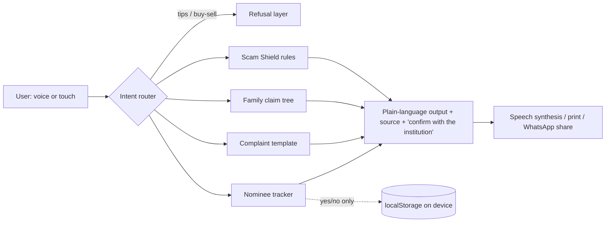

# हक़ साथी · Haq Saathi

**Investor protection for Bharat: know your rights, spot scams, claim what is yours. In Hindi and English, by voice or touch, on a low-end phone.**

Haq Saathi is a non-commercial, privacy-first progressive web app (PWA). It gives **no stock tips, no buy/sell/hold signals and no price predictions**. Built for the SEBI Securities Market Hackathon, Track B (Investor Awareness, Rights & Grievance Redressal).

**Live demo:** `https://<your-username>.github.io/haq-saathi/`

## Who it is for
Sarita, 66, a widow in a small town. Hindi-first, a basic phone, a son in another city. Her husband held shares, funds and bank deposits. Nobody told her where, or whether a nominee exists, and fake "recovery agents" are already calling.

## What it does
| Module | Problem it solves | How |
|---|---|---|
| 🛡️ **Scam Shield** | Fake recovery agents, tip groups, "guaranteed return" bait | On-device rule engine flags fee/OTP requests, urgency, impersonation; explains each flag; routes to 1930 / cybercrime.gov.in |
| 🕊️ **Family claim guide** | Heirs do not know which documents or institutions to approach | Asset and nominee questions, document checklist with readiness score, ordered steps (DP/CDSL-NSDL, CAMS/KFintech, bank, IEPF), WhatsApp share |
| 📝 **Complaint assistant** | First-time users cannot frame a complaint | Three questions produce a formal draft (print or listen), then the path: entity, SCORES, Smart ODR |
| 👨‍👩‍👧 **Nominee tracker** | Missing nominees cause unclaimed assets | Yes/no per account type, protection score, stored on the phone only |

## Architecture

- **Zero backend.** Static files; nothing is uploaded. Offline via service worker.
- **Auditable by design.** Legal steps and scam flags are explicit rules in `js/rules.js` and `js/app.js`, not a black-box model. Every flag shows why.
- **Voice:** Web Speech API today (hi-IN / en-IN). Roadmap: Bhashini ASR/TTS for 20+ languages.

## Guardrails
| Rule | How it is enforced |
|---|---|
| No advice or tips | `NOADVICE` refusal layer, covered by `tests/guardrails.test.js` (also tests it does *not* block heirs saying "shareholder") |
| Privacy | No SMS/OTP/PAN/account numbers collected. Scam text is analysed in memory and never stored. Only nominee yes/no is saved locally |
| Honest uncertainty | Scam Shield states it can miss scams; every legal step cites its source and says to confirm with the institution |
| No monetisation | No ads, accounts, analytics, or broker links |

## How it maps to the evaluation criteria
| Criterion | Evidence in this repo |
|---|---|
| Resilience & safety (30%) | Scam Shield, claim-readiness score, nominee gaps, fraud warning on every flow |
| Bharat-first usability (25%) | Hindi default, voice in/out, large touch targets, icon-led, 21 KB of app code, offline PWA |
| Guardrails & trust (15%) | Refusal layer + tests, on-device only, uncertainty disclosed |
| Technical execution (15%) | Rules where auditability matters, speech where literacy is a barrier, service worker for low bandwidth |
| Feasibility (15%) | Static hosting, MIT licence, content is data-driven and easy for investor associations to extend |

## Run locally
```bash
git clone https://github.com/<your-username>/haq-saathi && cd haq-saathi
npm start        # serves on localhost (or open index.html)
npm test         # guardrail and scam-rule tests
```

## Deploy (live demo)
Push to `main`. In **Settings → Pages**, set Source to **GitHub Actions**. The workflow in `.github/workflows/pages.yml` runs tests and publishes.

## Roadmap
1. More languages and Bhashini voice. 2. Cited answers over SEBI circulars (retrieval only, no generated legal advice). 3. Hand-off deep links to SCORES and IEPF. 4. Pilots with senior-citizen and investor-association programmes.

*Not legal or investment advice. Procedures and timelines change: confirm with the institution or the official SEBI website.*
